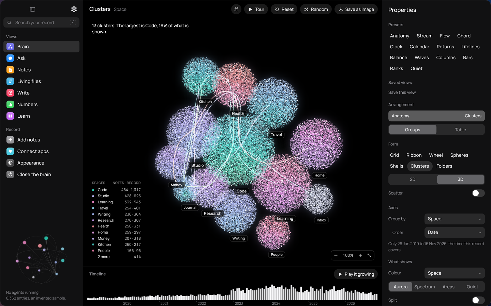

# Wit

Wit reads your notes and AI chats, files them into folders, links related entries, and draws everything as points
you can rotate, sort, zoom into and search. It runs on your computer. Your notes are not uploaded anywhere.



## Features

- **Views.** The record drawn on a human figure, or as clusters, a grid, a wheel, spheres, shells or a folder tree.
  Thirteen preset charts (stream, chord, clock, calendar and others) answer specific questions about your notes.
- **Zoom and dive.** Scroll zooms toward the pointer. Up close, entries show their titles. Click a group to
  highlight it; click it twice to show only that group, broken down by folder, then by date, then by entry.
- **Threads.** Summary notes are drawn as lines through the groups they draw from.
- **Search and command bar.** `/` searches. `Cmd-K` (`Ctrl-K`) jumps to any view, page, space, theme or entry.
- **Saved views, similar entries, a guided tour.**
- **Import.** Markdown, text, Obsidian vaults, and ChatGPT or Claude data exports.
- **Ask.** Optional. Ask a question and an AI you choose (Claude, OpenAI, or a local model) answers from your own
  entries, with citations. Off until you turn it on.
- **Connect apps.** Claude Desktop, Claude Code, Codex and Cursor can search Wit and save notes to it (MCP).
  Claude Code and Codex sessions can be imported automatically.

## Run

Requires Node.js 18 or newer.

```
npm install
npm start
```

`app/index.html` also works on its own in a browser, without the desktop features.

## Build

```
npm run dist:mac      # .dmg for Apple silicon and Intel, run on a Mac
npm run dist:win      # Windows installer
npm run dist:linux    # AppImage
```

Output goes to `dist/`.

### Signing and notarizing on macOS

Without this, macOS warns that it can't verify the app. It requires an Apple Developer Program membership.

1. In Xcode, Settings > Accounts > Manage Certificates, create a **Developer ID Application** certificate.
2. At account.apple.com, create an app-specific password.
3. Find your Team ID at developer.apple.com/account.
4. Build:

```
export APPLE_ID="you@example.com"
export APPLE_TEAM_ID="ABCDE12345"
read -s -p "App-specific password: " APPLE_APP_SPECIFIC_PASSWORD; export APPLE_APP_SPECIFIC_PASSWORD; echo
npm run dist:mac
npm run check:mac     # should report "accepted" and "Notarized Developer ID"
```

If those variables aren't set, the build is unsigned.

### Mac App Store

The App Store build runs in Apple's sandbox, so two things work differently:

- **Connect apps** shows each app's setup to copy and paste. Wit doesn't edit other apps' settings files.
- **Claude Code and Codex sessions** are read only after you choose the `~/.claude` or `~/.codex` folder once.

You need, from developer.apple.com:

1. An App ID for `com.vorinos.wit` (the bundle ID in `package.json`).
2. Certificates: **Apple Distribution** and **Mac Installer Distribution**.
3. A **Mac App Store Connect** provisioning profile for that App ID, saved as `build/embedded.provisionprofile`.

Then:

```
npm run dist:mas      # dist/mas-universal/Wit-<version>-universal.pkg
```

Upload the `.pkg` with Apple's Transporter app, then fill in the listing in App Store Connect (screenshots, a
privacy policy URL, the privacy questions) and submit it for review.

To test the sandboxed app on your own Mac first, use an **Apple Development** certificate and a **macOS App
Development** profile saved as `build/development.provisionprofile`, then `npm run dist:mas-dev`.

## Connecting AI apps

Open **Connect apps** in the sidebar.

| App | What Wit does | Then |
| --- | --- | --- |
| Claude Desktop | Adds `wit` to `claude_desktop_config.json` | Restart Claude Desktop |
| Claude Code | Runs `claude mcp add-json --scope user wit ...` | Start a new session |
| Codex | Adds `[mcp_servers.wit]` to `~/.codex/config.toml` | Start a new session |
| Cursor | Adds `wit` to `~/.cursor/mcp.json` | Enable it under Settings > MCP |
| ChatGPT | Serves the record locally; you expose it with a tunnel | Add a custom connector in developer mode |

Wit only edits its own `wit` entry and keeps a `.wit-backup` of the original file. **Copy setup** shows the config
if you'd rather add it by hand.

MCP tools: `search`, `fetch`, `overview`, `timeline`, `add_note`.

For ChatGPT: turn on **Serve Wit for ChatGPT**, run `cloudflared tunnel --url http://127.0.0.1:8765`, and add
`https://<tunnel>.trycloudflare.com/mcp/<token>` as a connector with no authentication. Anyone with that URL can read
your record while the tunnel is running.

## Privacy

- The interface has no network access. `main.js` blocks every request from it.
- The app process only contacts the AI provider you picked for Ask (`api.anthropic.com`, `api.openai.com`, or
  `localhost`), and serves `127.0.0.1` while the ChatGPT option is on.
- Ask sends your question and excerpts from up to 12 matching entries, and asks before the first time.
- API keys are stored in the system keychain.
- Connected apps read `record.json` in Wit's data folder and write notes to `inbox.jsonl`. Remove my notes deletes
  both.

## Layout

```
app/index.html      the interface, one self-contained file
main.js             window, IPC, settings
preload.js          the bridge between the page and main.js
desktop/            sources.js (Claude Code, Codex), exports.js, connect.js, ai.js
mcp/wit-mcp.js      MCP server, stdio or HTTP (node mcp/wit-mcp.js --http 8765)
test/               npm test
tools/symbols.py    generates the icon set
build/icon.png      app icon
```

## Status

Tested: the modules, `main.js` against a stubbed Electron (including the sandboxed App Store mode), the interface in headless Chrome, and the MCP server over
stdio and HTTP. An earlier build has been run on macOS; this version has not been checked on a Mac yet. Windows
and Linux builds and signing with a real certificate have not been tried.

## Credits

- Figure: sampled from Z-Anatomy (CC BY-SA 4.0), built on BodyParts3D, (c) The Database Center for Life Science.
  The point atlas derived from it is in `app/index.html` under the same licence.
- Web page backdrop: adapted from the Warp shader in Paper Shaders (Apache-2.0).
- Manrope: SIL Open Font License, see `app/OFL-Manrope.txt`.
- Claude, ChatGPT, Codex and Cursor names and logos belong to their owners.
